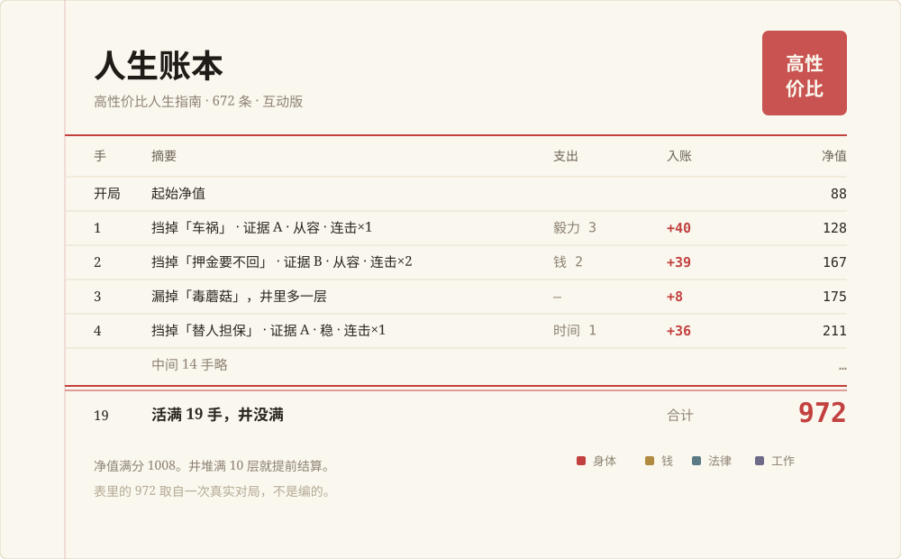
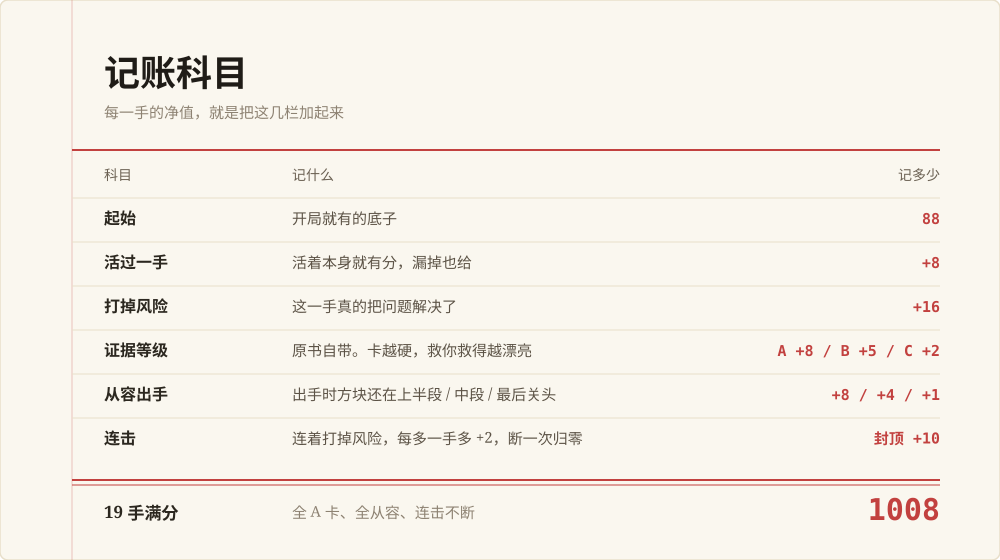
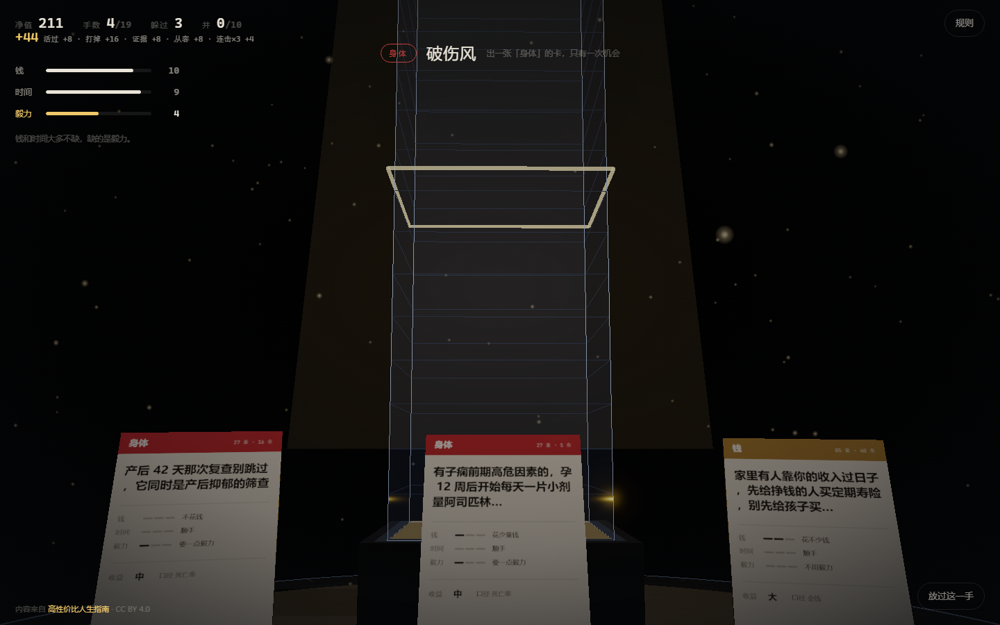
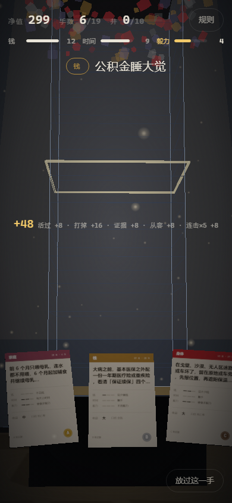
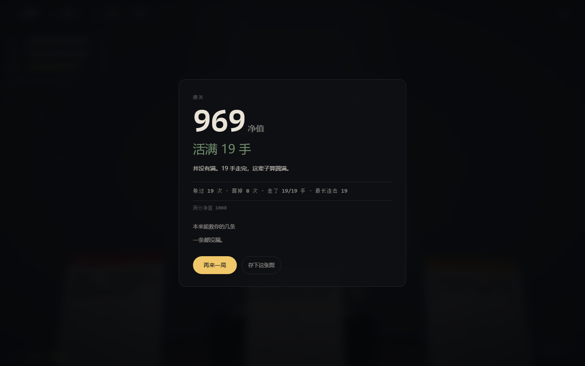

<div align="center">

# 人生账本 · life-ledger

**《高性价比人生指南》672 条建议，做成了能玩的一本账。**

风险从井口掉下来，你用手上三张卡把它挡掉。
挡得漂亮就多记一笔，漏了就堆在井里。堆满 10 层，这本账就结了。

[](#license)
[](https://github.com/eternity4719/HowToLiveBetter)
[](./public/cards.json)
[](https://threejs.org/)

</div>



---

## 这是什么

一本可以玩的人生账本。

原书《高性价比人生指南》里有 672 条循证建议，每条都带成本、收益、证据等级和原始出处。这个项目把它做成了一款浏览器 3D 游戏：**人生里的坑从井口掉下来，你用手上的建议卡把它挡掉，每一手都记进你的净值。**

输了不会真的死，但你会看到那口井里堆着什么，以及哪一条建议本来能救你。

## 三十秒上手

```bash
npm install
npm run dev        # http://localhost:3100
```

开局会有规则页。点「开始」，然后：

- **点卡片**（或按 `1` `2` `3`）出一张牌
- **长按卡片**看这条建议的完整内容（电脑上是把鼠标停在卡片上）
- **空格**放过这一手

## 玩法：一口井，三张卡，一次机会

**① 井口掉下一个风险。**
车祸、押金要不回、替人担保、自动续费。顶上写着它属于哪个「域」，一共 7 个：身体 / 精力 / 钱 / 法律 / 工作 / 家庭 / 误区。

**② 你手上三张卡，每张是原书的一条建议。**
卡面写着它的域，和三项成本：**钱 / 时间 / 毅力**。成本是原书本来就标好的。

**③ 出一张同域的卡、而且付得起，就把风险打掉。**
域不对没有用。域对了但付不起，也没用。

**④ 每个风险只有一次机会。**
点错了（域不对，或者付不起），方块直接砸下去，井里多一层，进下一个风险。
**没有第二次机会，这不是难度，是设计。**

**⑤ 撑满 19 手、井没堆满 10 层，这本账就算结得漂亮。**
井满了就提前结束，结算页会告诉你死在哪一条，以及哪几条建议本来能救你。

### 为什么是「账」

因为你手上的东西本来就是有限的：

| 资源 | 起始 | 上限 | 每手回 |
|---|---|---|---|
| 钱 | 8 | 12 | +2 |
| 时间 | 6 | 10 | +2 |
| **毅力** | **4** | **8** | **+1** |

原书里 529 条不花钱、529 条顺手，真正稀缺的只有**毅力**。所以这游戏的核心不是「能不能做」，是「值不值得做」。

每一次决策都有成本和收益，那就该记账。

## 记账科目

净值不是随便给的，是六栏加起来。每一手的数字都不一样，但你不用自己算。



| 科目 | 记什么 | 记多少 |
|---|---|---|
| 起始 | 开局就有的底子 | **88** |
| 活过一手 | 活着本身就有分，漏掉也给 | **+8** |
| 打掉风险 | 这一手真的把问题解决了 | **+16** |
| 证据等级 | 原书自带。卡越硬，救你救得越漂亮 | **A +8 / B +5 / C +2** |
| 从容出手 | 出手时方块还在上半段 / 中段 / 最后关头 | **+8 / +4 / +1** |
| 连击 | 连着打掉风险，每多一手多 +2，断一次归零 | **封顶 +10** |

**19 手满分 = 1008。** 全 A 卡、全从容、连击不断才拿得到。一般好局落在 850 到 950 之间。

几个设计上的选择：

- **「从容」看的是方块落到哪了，不是绝对秒数。** 下落速度每一手都在变（从 12 秒一路压到 6.4 秒），用秒数算不公平。
- **连击断一次就归零。** 顺境是复利的，逆境的代价也是。
- **发牌保证你手上至少有一张「域对且付得起」的牌。** 一锤定音之后，如果唯一那张域对的牌恰好付不起，你怎么点都必输一层，那不叫选择，叫坑。

## 截图

桌面端。左上角那个 `+44` 就是这一手的账：活过 +8、打掉 +16、证据 +8、从容 +8、连击×3 +4。



手机端。顶栏是净值 / 手数 / 井，长按卡片看详情。



手机上的预览是一层半透明 HUD，左右滑换牌，像看相册。点空白处退出。


结算页。969 是这个项目自己跑出来的一局。



## 数据与合规

**这一节比上面的玩法重要。**

- 内容来自 **[《高性价比人生指南》](https://github.com/eternity4719/HowToLiveBetter)**，作者 eternity4719。**内容授权 CC BY 4.0，代码授权 MIT。**
- 本项目是它的**衍生作品**。依 CC BY 4.0，衍生作品**必须署名**，所以页面页脚、结算页、分享图、这份 README 都标了来源和许可。**你要是 fork 去做别的，请把署名一起带走。**
- 原书作者明确写过：**「本项目从未发行、也不会发行任何代币或数字资产。」**
  本项目同样**不涉及任何代币、NFT 或链上资产**，也请不要往这个方向用。
- 原书的**「成本」一栏是作者按市面价格的粗略估计，不是权威数据**。本作只把它当游戏数值用，任何地方都不该拿它当真实花费引用。
- 每条建议都**保留原书的证据等级和来源**，卡面右下角就能看到。
- 本项目与原作者**无从属关系**，不代表原作者观点。原书是严谨的建议合集，这里是一款游戏。

想把数据从源头重建，而不是用仓库里已经解析好的 `public/cards.json`：

```bash
git clone https://github.com/eternity4719/HowToLiveBetter ../.htlb/HowToLiveBetter
npm run cards      # 解析 book/*.md → public/cards.json
```

## 技术栈

| | |
|---|---|
| 语言 | TypeScript，无框架，运行时只依赖 three |
| 3D | Three.js + EffectComposer（半分辨率泛光） |
| 构建 | Vite |
| 数据 | 构建期把 672 条 markdown 解析成静态 JSON，运行时 fetch |
| 字体 | 系统字体栈，不下载外部字体 |

```
src/
  engine.ts          纯逻辑：回合、资源、计分、结算。不碰 DOM，不碰 3D
  main.ts            接线层：引擎事件 → HUD / 场景 / 提示
  data/              域的配色与成本换算表
  scene/
    WellScene.ts     井、手牌、下落、碎裂、相机取景
    textures.ts      卡面 / 层贴图 / 分享图，全部 Canvas 现画
tools/
  build-cards.mjs    解析原书 markdown → public/cards.json
  verify-*.cjs       四个验证脚本
public/cards.json    672 条，1.8MB
```

**引擎和场景是分开的。** 引擎不认识 Three.js，场景不认识规则。两边只通过几个事件来回传，所以计分规则能在无头环境里被完整验证，不用等渲染。

## 验证

不是「跑起来看着没报错」，是四个会真的断言、失败就退非零退出码的脚本：

```bash
npm run verify:score     # 计分规则：满分 1008、每手构成、连击递增与归零、
                         # 一锤定音的两种选错、发牌保底、HUD 与结算一致
npm run verify:preview   # 预览交互：真实触摸滑动与循环、点空白退出、
                         # 三张选项呈现一致、滑动不能被浏览器 pointercancel 打断
npm run verify:flow      # 完整流程：出牌、放过、堆满 10 层、导出分享图
npm run verify:stack     # 自然落地逐层检查，确认方块真的往上堆而不是重叠
```

脚本用 Playwright 的 headless shell 跑，需要 `NODE_PATH` 指向装有 `playwright-core` 的目录。

**手机端交互一律用真实触摸事件**（CDP `Input.dispatchTouchEvent`）驱动。
Playwright 的 `mouse.*` 产生的是鼠标事件，不经过浏览器的手势仲裁，用它测滑动会得到假绿：
横滑被浏览器抢走手势、页面收到 `pointercancel`、面板根本换不了张，而鼠标测法照样「通过」。

## 已知取舍

- **一锤定音是有意的。** 真实的人生不给试错，所以这里也不给。
- **19 手和 10 层是配着满分 1008 一起调出来的**，改一个要连着改另一个。
- **3D 用固定步长**（单帧 `delta` 上限 0.05 秒）。极低帧率的机器上动画会慢下来，换来的是逻辑不会因为一帧卡顿就乱跳。
- **镜头不能自由旋转**，只做正负 3 度的视差。井是要看层数的，转起来反而看不清。
- **半分辨率泛光必须在 `EffectComposer.addPass()` 之后再 `setSize`**，因为 `addPass` 会把 pass 尺寸重置成整屏。这个坑踩过两次。

## License

- **代码**：MIT。`LICENSE` 文件还没补，补之前请先当作「保留所有权利」。
- **内容与数据**：CC BY 4.0，版权归 [HowToLiveBetter](https://github.com/eternity4719/HowToLiveBetter) 作者 eternity4719。
- 本项目与原作者无从属关系。

<div align="center">

**算清每一笔，别让井满了才想起来。**

</div>
